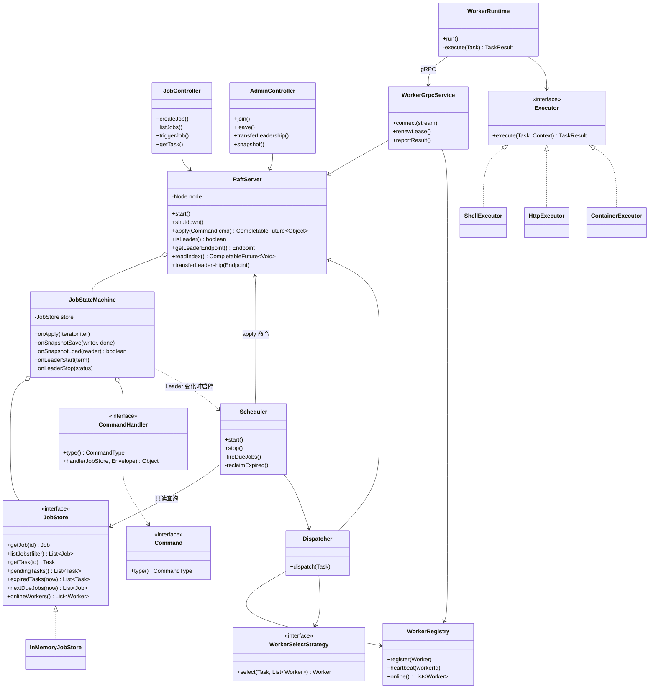

# Raft Job Keeper 类关系概要设计

> 📖 **前置阅读：** [Raft 共识算法简介](./00-raft-primer.md)、[架构设计](./01-architecture-design.md)。

使用 Java 21 描述。根包 `io.ytong.raftjobkeeper`，模块与子包划分见架构设计第 3 节。Raft 实现库为 SOFAJRaft（`com.alipay.sofa.jraft`）。

## 1. 类图总览



## 2. 领域对象（`common.model`）

使用 Java record / 枚举，不可变对象在 FSM 中替换整体，便于快照与并发读。

```java
public enum TaskStatus { PENDING, RUNNING, SUCCEEDED, FAILED, TIMEOUT, CANCELED }
public enum ConcurrencyPolicy { ALLOW, FORBID, REPLACE }

public record Job(
    String id, String name, Payload payload,
    Duration timeout, int maxRetry, Duration retryBackoff,
    ConcurrencyPolicy concurrency,
    JobStatus status, long version) {}

public record Task(
    String id, String jobId, Instant fireTime, TaskStatus status,
    String workerId, Instant leaseExpireAt, int attempt, String result,
    Instant startedAt, Instant finishedAt) {}

public record Worker(
    String id, String address, Map<String, String> labels,
    int capacity, int running, Instant lastHeartbeat, WorkerStatus status) {}
```

## 3. 命令（`server.fsm.command`）

```java
public enum CommandType {
    CREATE_JOB, UPDATE_JOB, DELETE_JOB, SET_JOB_ENABLED,
    FIRE_JOB, ASSIGN_TASK, RENEW_LEASE, REPORT_TASK, EXPIRE_TASK,
    REGISTER_WORKER, WORKER_HEARTBEAT, REMOVE_WORKER
}

// 写入 Raft 日志的内容，protobuf 序列化
public record Envelope(
    CommandType type,
    String requestId,   // 幂等键
    Instant now,        // 由 Leader 写入，FSM 不读本地时钟
    byte[] body) {}
```

每种命令一个 `CommandHandler` 实现（如 `FireJobHandler`、`AssignTaskHandler`），`JobStateMachine` 持有 `Map<CommandType, CommandHandler>` 分发。

## 4. 主要类职责

### 4.1 `server.raft.RaftServer`
封装 SOFAJRaft 的 `RaftGroupService`、`Node`、`CliService`。
- 配置：RocksDB 存储日志/元数据/快照目录均在 `/data`；Raft 端口 7000。
- `apply(Command)`：序列化为 `Envelope` → 封装成 `com.alipay.sofa.jraft.entity.Task` → `node.apply(task)`，通过 `Closure` 回调完成 `CompletableFuture`；非 Leader 抛出 `NotLeaderException(leaderEndpoint)`。
- `readIndex()`：封装 `node.readIndex()`，用于线性一致读。
- 成员管理：`addPeer` / `removePeer` / `transferLeadershipTo`。

### 4.2 `server.fsm.JobStateMachine`
继承 SOFAJRaft 的 `StateMachineAdapter`。
- `onApply(Iterator)`：循环取出已提交日志，反序列化 `Envelope`，交给对应 `CommandHandler`；若 `iter.done() != null` 则回调结果给提交方。幂等：已处理的 `requestId` 直接返回。
- `onSnapshotSave` / `onSnapshotLoad`：序列化 / 恢复 `JobStore` 全量数据。
- `onLeaderStart(term)` / `onLeaderStop(status)`：启停 `Scheduler`。

### 4.3 `server.store.InMemoryJobStore`
- `ConcurrentHashMap<String, Job>`、`Task`、`Worker`。
- 索引：`pendingTasks`、`leaseQueue`（按 `leaseExpireAt`）、`tasksByJob`。
- 写入只发生在 `onApply`（单线程）；读取来自 REST 与 Scheduler，使用 `ReentrantReadWriteLock`，读接口返回不可变拷贝。

### 4.4 `server.scheduler.Scheduler`
- 仅 Leader 运行，`ScheduledExecutorService` 驱动；`start()` 前先确认历史日志已应用完毕。
- 用户触发运行由 `JobController` 提交 `FIRE_JOB`（预生成 `taskId`，用 `requestId` 去重），结合 `ConcurrencyPolicy` 决定是否接受；`Scheduler` 不再负责定时触发。
- `reclaimExpired()`：扫描租约过期任务与离线 Worker，提交 `EXPIRE_TASK`；失败且未超过 `maxRetry` 的任务按 `retryBackoff` 重新入队。
- 退位时通过 `Future.cancel` 与中断停止所有周期任务。

### 4.5 `server.dispatcher.Dispatcher` / `WorkerRegistry`
- `WorkerSelectStrategy` 策略接口：`LeastLoadedStrategy`（默认）、`LabelMatchStrategy`、`RoundRobinStrategy`。
- `dispatch(Task)`：选出 Worker → 提交 `ASSIGN_TASK` → 成功后通过该 Worker 的 gRPC 流推送任务。
- `WorkerRegistry` 维护 Worker 的 gRPC 流连接（连接信息仅在内存，仅 Leader 持有；Worker 重连后重建）。

### 4.6 `server.api`
- `JobController`（`@RestController`）：用户 REST 接口；写操作调用 `RaftServer.apply`；读操作支持 `consistency=strong|stale`，strong 时先 `readIndex()`。
- `AdminController`：`/admin/**` 管理接口，包括集群 Join / Leave、`transfer-leadership`、手动触发快照、集群状态；仅集群内部或带管理 token 可访问。
- `HealthController`：`/healthz`、`/readyz`、`/leaderz`。
- `WorkerGrpcService`：继承 grpc-java 生成的 `WorkerServiceGrpc.WorkerServiceImplBase`，提供双向流 `connect`；Worker 心跳在 Leader 本地聚合后每 N 秒批量提交 `WORKER_HEARTBEAT`，租约续约同理，以减少 Raft 日志量。非 Leader 收到连接时返回 Leader 地址让 Worker 重定向。

### 4.7 `worker.WorkerRuntime` 与 `Executor`
- `WorkerRuntime`：向 Leader 注册（通过 `SERVER_ADDR` 找到 Leader）、维护并发槽位（`Semaphore`）、周期续约租约、上报结果；连接断开后指数退避重连。
- `Executor`（策略模式）：`ShellExecutor`、`HttpExecutor`、`ContainerExecutor`（创建 K8s Job 运行）；统一支持超时与取消，用 `taskId + attempt` 作为幂等标识。

### 4.8 `server.cluster.PeerDiscovery`
接口 `List<Endpoint> peers()`；实现 `DnsPeerDiscovery`（解析 headless Service）与 `StaticPeerDiscovery`（配置文件）；`ClusterBootstrapper` 负责首次引导与 Join。

## 5. 关键时序

### 5.1 创建作业
```
Client -> JobController.createJob -> RaftServer.apply(CREATE_JOB)
  -> Raft 复制并提交 -> JobStateMachine.onApply -> CreateJobHandler -> JobStore.add
  -> 回调完成 CompletableFuture -> 返回 jobId
```

### 5.2 触发与执行
```
User -> JobController.runJob -> RaftServer.apply(FIRE_JOB)    => Task(PENDING)
Dispatcher.dispatch     -> RaftServer.apply(ASSIGN_TASK) => Task(RUNNING, 租约)
Dispatcher -> Worker（gRPC 流推送）-> Executor.execute
Worker -> RenewLease（周期） / ReportResult
WorkerGrpcService -> RaftServer.apply(REPORT_TASK) => SUCCEEDED / FAILED
```

## 6. 并发与错误处理约定

- `onApply` 由 SOFAJRaft 单线程串行调用；其他线程读 `InMemoryJobStore` 必须持读锁。
- 所有提交到 Raft 的调用带超时（默认 5s）；异常区分 `NotLeaderException`、`TimeoutException`、`ApplyFailedException`，调用方按类型重试或重定向。
- Leader 退位时取消 Scheduler / Dispatcher 的所有任务，避免旧 Leader 继续提交（即使提交也会被 Raft 拒绝，但应尽早停止）。
- REST 层用 `@ControllerAdvice` 将异常映射为 HTTP 状态码（如 `NotLeaderException` → 307 + `Location` 指向 Leader）；gRPC 层映射为 `Status`。
