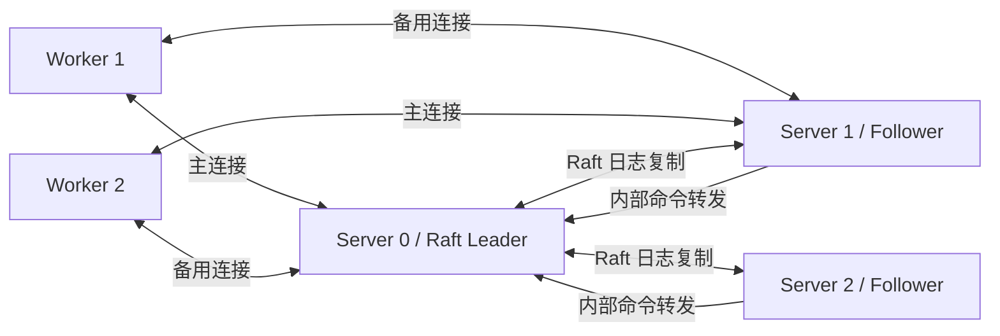

# 多 Job Keeper Server 同时工作与 Worker 多连接改造方案

本文基于当前仓库实现梳理改动范围，仅提出设计，不代表功能已经实现。与 [现有架构讨论](DESIGNS/04-architecture-discussion.md) 议题三配套，重点补充代码落点、连接归属和故障恢复。

## 1. 目标与建议

当前已经能部署多个 Server 组成 Raft 集群，但业务调度仍集中在 Leader。目标改为：所有 Server 都能接入 Worker、挑选任务、推送任务并处理上报；所有任务状态变更仍通过同一个 Raft Leader 排序并提交。

需要区分两种连接目标：

| 模式 | 连接方式 | 额外成本 |
| --- | --- | --- |
| 任意节点接入 | 每个 Worker 保持一条连接，不同 Worker 分布在不同 Server | 需要迁移连接归属、全局容量和转发写入 |
| 同一 Worker 多连接 | 每个 Worker 同时连接多个 Server | 还需要连接集合、唯一调度归属及跨连接去重 |

建议最终采用“多条连接、一个调度 owner”：Worker 可以同时连接 S0/S1/S2，但每个 Worker 在任一时刻只有一个 Server 获准给它分派新任务，其余连接用于备用、状态同步及故障接管。不同 Worker 的 owner 分散在不同 Server，因此多个 Server 仍同时工作。先实现任意节点接入，再增加备用连接，可降低第一阶段复杂度。

不建议第一版让所有连接同时向同一个 Worker 无差别派发；如果确实需要，必须依靠 FSM 里的全局容量预留和 Worker 的原子准入，不能把 capacity 按连接复制。



多节点调度可以分摊连接维护、任务挑选和消息处理，不能突破单 Raft 组的写入瓶颈。跨机房时 Worker 接入链路可本地化，但续租和结果提交仍需经过 Leader 和多数派。

## 2. 当前实现的限制

| 位置 | 当前行为 | 改造影响 |
| --- | --- | --- |
| `WorkerGrpcService.register()` | Follower 返回 REDIRECT 并关闭流 | 改为所有节点接入，注册通过统一命令入口提交 |
| `Dispatcher.scan()` | 非 Leader 调用 `workers.closeAll()` 后退出 | 拆开调度和维护职责，Follower 不再因角色变化关闭 Worker 流 |
| `RaftServer.apply()` | 非 Leader 拒绝写入 | 新增 Server 间命令转发 |
| `WorkerRegistry` | 本机 `workerId -> Session`，容量只看本机 taskIds | 本地连接与全局业务归属分离 |
| `JobStore.assignTask()` | 只检查 PENDING | 增加 attempt、版本、owner 和容量检查 |
| `JobStore.renewLease()` | 校验 RUNNING 与 workerId，不校验 attempt | 旧执行实例可能续约新任务，需增加执行身份校验 |
| `JobStore.reportTask()` | 校验 workerId、attempt | 增加 assignmentId、结果幂等及结构化返回 |
| `WorkerRuntime` | 一个 `SERVER_ADDR`、一个 `activeConnection` | 多地址发现、独立连接管理和统一任务执行器 |
| `WorkerRuntime.reportOnce()` | 仅尝试发送一次，未等提交 ACK | 断线可能丢结果，增加待确认结果与重试 |
| `TaskAssignment.term` | Worker 拒绝低于最高 term 的任务 | Follower 的 `currentTerm()` 在当前 FSM 中不是有效的派发凭据，需要替换 |

`Worker.running` 目前没有随任务分派和完成维护；不能直接把它当成已存在的全局容量控制。当前本地 reserve 只能减少单进程竞争，无法控制多个 Server 的总分派量。

## 3. 状态边界和新增字段

### 3.1 本地状态

每个 Server 只保存自己的 gRPC stream、发送队列、连接活性和待提交请求。stream 对象不能放进 Raft 日志或快照。向同一个 stream 的写入必须串行化，并提供有界队列、背压和关闭清理，避免 Dispatcher、ACK、CANCEL 并发写流。

每个 Worker 有一个执行器和一个全局容量控制器，所有连接共享。不能为每条 Server 连接分别创建容量为 capacity 的执行池。

### 3.2 Raft 复制状态

建议补充以下逻辑字段，具体可拆为独立 record：

| 实体 | 建议字段 | 用途 |
| --- | --- | --- |
| Worker | `workerId, incarnationId, capacity, ownerServerId, ownerEpoch, ownerLeaseExpireAt` | 区分进程重启、唯一调度归属及接管 |
| Worker 连接 | `serverId, sessionId, incarnationId, expiresAt` | 需要多连接发现时记录连接租约；高频探活仍留本地 |
| Task | `attempt, assignmentId, workerIncarnationId, ownerEpoch, version` | 区分每次执行与旧请求，支持条件更新 |
| 命令 | `requestId, protocolVersion` | 转发重试幂等及协议演进 |
| 提交结果 | `code, requestId, assignmentId, appliedIndex, taskVersion` | 区分成功、冲突、过期与暂时不可用 |

`ownerEpoch` 在 FSM 每次成功接管时递增，不能使用 Server 本地计数。`incarnationId` 标识 Worker 进程实例，`sessionId` 标识单条连接，二者不能混用。旧连接断开只能删除匹配的 session，不能注销 Worker 的其他连接。

任务租约和 owner 租约是两件事：更换接入 owner 不应立即重跑仍在执行的任务。保留原 assignmentId，通过新连接恢复续约和结果上报；新任务必须使用当前 ownerEpoch。

## 4. Server 侧必须改动

### 4.1 统一命令提交与 Follower 转发

在现有 `RaftServer.apply()` 外增加 `CommandGateway.submit()`：Leader 本地提交；Follower 通过内部 RPC 转发给 Leader。内部入口需要节点身份认证、超时、请求大小限制和有限重试；禁止无限互相转发。

同一次操作重试必须沿用 requestId 和命令内容。Leader 更换或超时时，结果可能已经提交，调用方不能把“未收到响应”当成“没有成功”。返回 NOT_LEADER 时刷新路由，再用相同 requestId 查询或重试。

成功返回必须表示命令已经提交并应用，不能在转发成功或入队后提前 ACK。若返回时接入 Follower 的本地 FSM 尚未应用到 appliedIndex，要等待本地追平，或使用响应里携带的权威 assignment 数据；不能拿旧的本地 Task 拼装推送。

FSM 的业务条件冲突返回确定的结果码，例如 `CONFLICT`、`STALE_ASSIGNMENT`、`CAPACITY_FULL`，不把正常竞争当成状态机运行异常。

### 4.2 全节点调度，维护扫描先保留 Leader 执行

拆分当前 `scan()`：

- 所有 Server 执行 dispatch，只选本机存在有效连接、且 owner 为本机的 Worker。
- 过期回收、Worker 淘汰、历史清理先保留 Leader 执行，避免所有节点重复提交相同维护命令。
- CANCEL 按任务对应 Worker 的当前 owner 路由发送；可由 owner 监听本地已应用的取消状态，也可走内部通知，通知只是加速手段。
- owner 接管必须通过 Raft CAS，检查旧租约和预期 epoch，不能用各节点本地超时直接宣告接管成功。

扫描本地旧状态可以用于产生候选任务，最终决策必须由 FSM 校验。增加本机 in-flight 集合、有限批次、随机退避以减少重复争抢；哈希首选节点只是优化，不能作为互斥依据。

### 4.3 将 ASSIGN_TASK 变为完整条件命令

建议命令包含：

```text
AssignTask {
  requestId, taskId, expectedAttempt, expectedVersion,
  assignmentId, workerId, workerIncarnationId,
  ownerServerId, ownerEpoch, leaseExpireAt
}
```

FSM 按日志顺序原子检查：任务仍 PENDING、attempt/version 一致、到达 availableAt、Worker 有效、owner/epoch/incarnation 匹配，以及全局占用未达 capacity。通过后记录 assignment 并占用一个名额；失败不改变任何状态。两个 Server 抢同一任务只能一个成功。

全局名额可通过任务表推导，或维护索引/计数；若维护计数，必须在 REPORT、EXPIRE、REPLACE 取消等所有退出路径恰好释放一次，并在快照恢复时保持一致。重连不能把已有 RUNNING 数量清零。

只有成功提交的 assignment 才能被推送。分派响应应携带确定的 attempt、assignmentId 和执行参数或不可变 payload 版本，避免等待期间 Job 更新导致推送内容与分派记录不一致。

### 4.4 提交与投递之间的恢复

Raft 提交和 gRPC 推送无法做成一个原子操作，应明确采用“持久化分派 + 至少一次投递 + 去重”：

1. 分派提交后发送 TASK，Worker 返回带 assignmentId 的 ACCEPTED 或 REJECTED。
2. 已提交但未确认接收的 assignment 可以重发；新 owner 通过状态对账恢复投递。
3. Worker 对同一 assignment 的重复 TASK 返回相同状态，不重复启动；已完成则补报缓存结果。
4. Worker 拒收或长期不可达，由带 assignmentId/版本条件的释放或过期流程回收。不能仅释放本地 reserve 就认为全局任务已撤销。

第一阶段可以先用现有任务租约超时回收补偿“提交后未推送”，但要接受这段等待时间；完整版本再增加投递状态/重发索引。

## 5. Worker 与协议改动

### 5.1 多连接管理

将单个 activeConnection 改为 `serverId -> Connection`，每条连接独立注册、退避重连和健康检查。通过 `SERVER_ADDRS` 或服务发现拿到具体节点地址，并动态处理扩缩容。

同一个 ClusterIP 上建立多条流不保证连到不同 Server。需要节点级地址、可连接的 gRPC advertised endpoint，并由握手返回 serverId 去重；现有仅暴露 Raft 端口的 headless Service 也需要补充 Worker 连接所需端口。

主连接由 Raft 中的 owner 结果决定，备用连接不能自行升为 owner。备用心跳仅用于维持连接/可达性，不应每条连接重复提交全量业务心跳。默认由主连接聚合运行任务并提交续约；主连接故障时允许经已认证的备用连接转交同一 assignment 的续约与结果。

### 5.2 扩展 worker.proto

新增字段采用新的 protobuf tag，不能复用已有编号。建议逐步用 enum 和 oneof 替换字符串 type，并保留明确的兼容期：

- REGISTER / REGISTERED：增加 serverId、incarnationId、sessionId、ownerServerId、ownerEpoch、协议能力和运行任务摘要。
- TASK / CANCEL：携带 assignmentId、attempt、Worker incarnation；CANCEL 必须针对具体 assignment，避免误取消后续重试。
- HEARTBEAT：批量携带运行 assignment，携带序列号并返回续约结果。
- RESULT / ACK：携带稳定 reportId、assignmentId、attempt、明确提交结果；ACK 必须能关联到具体报告。
- OWNER_CHANGED / RESUME：通知主备变化并进行执行状态对账。
- ACCEPTED / REJECTED：明确任务是否通过 Worker 容量准入及拒绝原因。

不同消息的授权规则应区分：新派发必须来自当前 owner；旧 assignment 的有效续约、补报可经备用 Server 转发，但最终由 FSM 核对 worker incarnation、assignmentId、attempt 和状态。

### 5.3 替换 term 判断，补齐原子准入和结果补报

当前 `highestTerm` 不能直接用于多节点派发：Follower 的 FSM `currentTerm()` 当前为 0，且 Raft term 不是任务执行身份。改为使用已提交的 assignmentId、attempt 和 ownerEpoch 校验，并保证接入 Server 只推送有提交依据的分派。

Worker 对新任务使用原子容量许可和 assignment 去重；当前 `running.size() >= capacity` 的检查在多连接并发回调下不够。新 ownerEpoch 只约束新派发，不应让旧 epoch 下仍有效的任务自动停止上报。

结果进入待确认 outbox，收到匹配的提交 ACK 才删除。跨连接重试使用相同 reportId。FSM 对同一报告返回原提交结果，不重复推进 attempt 或释放容量。需要覆盖 Worker 进程重启时，将 outbox 和去重记录持久化；仅内存缓存只能保证进程存活期间的补报。

## 6. 续约、时间与执行保证

- RENEW_LEASE 必须校验 taskId、assignmentId、attempt、workerIncarnationId；迟到的旧任务心跳不能给新 attempt 续租。
- EXPIRE_TASK 必须带预期 assignment/version，并在 FSM 检查租约确实到期；过期扫描与续约并发时以日志顺序和条件校验决定结果。
- FSM 不读取本机时钟。需要决定新命令时间的操作，由 Leader 接收新请求时生成并固化时间；同一 requestId 重试复用原命令。续租取有效期限的较大值或拒绝旧序列，避免迟到心跳缩短租约。
- owner/任务租约需要考虑节点时钟偏差、选举、网络往返和排队时间；失去多数派时停止新的分派确认，不能用本地成功代替提交成功。
- Server 的调度名额不等于 Worker 实际空闲：租约过期时旧执行可能仍运行，Worker 必须继续对真实执行做容量准入；旧执行停止或完成后才释放本机执行许可。

Raft CAS 能保证同一任务状态只有一个有效分派，不能保证外部副作用只发生一次。租约超时后重新执行时，旧 Worker 可能仍在执行 shell/HTTP 请求。业务需要使用幂等键；若依赖 fencing，必须由外部资源校验单调 token。Worker 只比较自己见过的 token 无法阻止尚未得知新分派的旧进程继续执行。

## 7. 故障处理

| 场景 | 预期处理 |
| --- | --- |
| Raft Leader 切换，接入 Server 仍活着 | 保持 Worker 连接，内部转发重新寻址，未确认命令使用原 requestId 重试 |
| owner Server 宕机 | Worker 使用备用流；接管者通过 owner CAS 获得新 epoch，恢复运行任务与容量 |
| Worker 重连或主备切换 | 对账 assignment 列表；不把已有任务当成空闲，也不把注册当作重新执行指令 |
| 分派已提交，响应或 TASK 丢失 | 查询/幂等重试原分派，重投同一 assignment；必要时由租约回收 |
| 任务完成，结果 ACK 丢失 | outbox 补报相同 reportId，返回原结果，不重复释放名额 |
| 旧连接迟到的续约、结果或 CANCEL | 精确校验 incarnation/assignment/attempt，拒绝过期操作 |
| Server 网络分区 | 少数派可维持连接和缓存结果，不能承诺新分派或续租成功 |
| Worker 断开一条备用流 | 仅移除对应 session，不将整个 Worker 标记离线 |
| Server / Worker 重启 | 从快照和持久化记录恢复；本地连接重新建立，再完成对账 |

## 8. 按文件的实施清单

| 文件或模块 | 需要修改的内容 |
| --- | --- |
| `job-keeper-common/src/main/proto/worker.proto` | 连接身份、assignment、结果关联、批量续约、主备和恢复消息 |
| common `model/Task.java`、`model/Worker.java` | assignment/version、进程实例、owner/epoch；必要时新增连接模型 |
| common `command/CommandType.java` | owner claim/renew/release、投递确认等命令与确定的结果模型 |
| server `raft/RaftServer.java` | 保留底层 Leader 提交，增加网关、内部转发及提交结果索引；明确各服务 advertised endpoint |
| server `fsm/JobStateMachine.java` | 返回结构化提交结果，复制新增状态；处理快照格式版本与恢复 |
| server `store/JobStore.java` | 全局 CAS、容量、assignment 续约/回收、owner 状态和幂等报告 |
| server `dispatcher/WorkerRegistry.java` | 本地多会话、安全移除、串行发送、从全局任务重建占用 |
| server `dispatcher/Dispatcher.java` | 全节点分派、owner 过滤、in-flight 去重、恢复投递及取消路由 |
| server `api/WorkerGrpcService.java` | 所有节点接入；注册状态机、转发提交、精确 ACK、备用连接及对账 |
| worker `runtime/WorkerRuntime.java` | 多地址多连接、原子容量、执行去重、主备切换、outbox 和恢复 |
| server `api/HealthController.java` | readiness 反映接入/转发能力；不得把 Leader 身份作为所有业务节点就绪条件 |
| `deploy/k8s/01-configmap.yaml`、`02-services.yaml`、`03-statefulset.yaml`、`05-worker-deployment.yaml`、`06-networkpolicy.yaml` | 节点 gRPC 发现、多地址配置、内部 RPC、网络放行和优雅下线 |
| 各模块测试与设计文档 | 多节点集成测试、快照兼容测试及架构说明更新 |

快照新增字段需提供旧格式默认值或显式迁移工具，不能默认 Jackson 能正确恢复所有新状态。没有协议能力的旧 Worker 继续运行旧接入模式；集群应先部署兼容代码，再启用多节点调度开关。未完成兼容设计前不允许混合版本直接开启新模式。

## 9. 实施顺序与验收

1. **先补一致性基础**：assignmentId、attempt/version CAS、全局容量、精确续约、幂等结果、outbox；保持单 Leader 分派，验证原行为。
2. **实现任意节点接入**：命令转发、单连接 owner、全节点 Dispatcher、迁移对账；先保留 Leader 执行维护扫描。
3. **实现同一 Worker 多连接**：服务发现、主备连接、owner 租约与 epoch、备用转交结果、自动接管。
4. **再做规模优化**：批量续约、冲突退避、投递重试、标签/亲和调度；仅在单组写吞吐实测不足时考虑多 Raft 组。

验收至少使用 3 个 Server 和多个 Worker，覆盖：

- 两个 Server 同时抢同一个 task/attempt，只产生一个有效 assignment；落后 Follower 提案也不能绕过条件校验。
- 同一 Worker 建立多条连接，Server 全局占用与 Worker 实际并行数都不超过 capacity。
- 杀掉 owner、切换 Raft Leader、重启 Follower，分别验证连接、运行任务、容量和结果恢复。
- 在提交后推送前、Worker 接收后确认前、结果提交后 ACK 前注入故障，验证重投/补报幂等。
- 新 attempt 开始后注入旧 HEARTBEAT、RESULT、CANCEL，不能改变新 assignment。
- 快照恢复、旧快照迁移、重复 session 清理后，不发生计数泄漏或错误归属。
- 少数派分区时不能确认新分派，恢复后可完成结果对账。

观测指标至少包含：每节点主/备连接数、owner 接管耗时、命令转发延迟、CAS 冲突率、租约续约失败率、未确认投递/结果数量、全局占用与本地执行数差异。

最终需要改的是完整的“连接—归属—分派—投递—续约—结果确认”链路。保留单 Raft 组即可让多个 Server 同时处理业务，但仅去掉 Leader 判断和 REDIRECT 还不足以安全运行。
